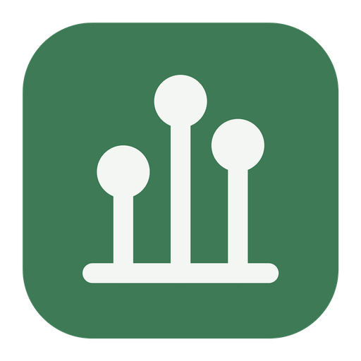

<h1 align="center">Bosk</h1>

**Run a whole team of coding agents side by side, each on its own branch, on Windows.**

A *bosk* is a small wood: several trees growing together. In Bosk, every tree is an agent working in its own git worktree, and you are the one walking between them.

[**Download the latest installer**](../../releases/latest) · [Release notes](../../releases)

---

## Why Bosk

AI coding agents are great until you want more than one at a time. Two agents in one checkout step on each other, juggling terminals gets messy, and you lose track of who is waiting for you. Bosk fixes that:

- **One agent, one worktree, one branch.** Agents never collide.
- **See who needs you.** Working, needs input, done: at a glance, with toasts and Windows notifications.
- **Review and ship from one place.** Diff, commit, push and open a PR without leaving the window.
- **Native on Windows.** Real ConPTY terminals, no WSL required.

## What you can do

**Work with any agent CLI**
Claude Code, Codex, OpenCode, Antigravity (`agy`) or a plain PowerShell, several tabs per agent. Pick a permission mode (Plan, Accept edits, Skip prompts, Default) per CLI, per project or per agent.

**Start from real work items**
Pick a GitHub issue or an Azure Boards work item and Bosk fills in the agent's name and task. The PR links back to it.

**Review without context switching**
A live diff against the commit the agent started from, a file browser with syntax highlighting, and commit straight from the panel.

**Push and track PRs**
Push the branch and open a draft PR on GitHub or Azure DevOps. See PR state and check/pipeline status in the header, and mark ready, merge or close from a menu.

**Preview what the agent built**
Every agent gets its own port block, so several dev servers run side by side. Listening ports are detected automatically and shown in a built-in Preview panel and a full **built-in browser** (WebView2 tabs, persistent sign-ins).

**Let agents orchestrate agents**
Agents get a `bosk` CLI and an MCP server to start, follow, read and message other agents. Tell one agent "split this across three agents" and it will. Guardrails keep you in charge: a cap on agents started, no pushing or PRs by agents, and browser control that is off until you allow it.

**Keep going when the app doesn't**
Terminals run in a small background host, so agents survive closing the window, crashes and updates. Closing hides Bosk to the tray.

**Stay up to date safely**
Built-in updates with release notes, verified against a signing key before they run.

## Under the hood

| | |
|---|---|
| App shell | [Tauri 2](https://tauri.app) |
| Backend | Rust: git, worktrees, terminals (`portable-pty` / ConPTY), local control API |
| UI | React + TypeScript, xterm.js |
| Browser | WebView2 |
| Agent integration | Status hooks, MCP server (stdio), `bosk` CLI, bundled skills |
| Local state | `~/.bosk` |

The control API listens on `127.0.0.1` only and requires a random per-session token.

## Install

1. Download the installer from the [latest release](../../releases/latest) and run it.
2. Start Bosk and add a local repository, or clone one by URL (`owner/repo` works for GitHub).
3. Create your first agent.

The installer adds the `bosk` command to your user `Path`. Your data in `~/.bosk` is kept across installs and uninstalls.

### Requirements

- Windows 10 or 11 (WebView2, built in on Windows 11)
- [Git for Windows](https://git-scm.com/download/win)
- The agent CLIs you want to use: `claude`, `codex`, `opencode`, `agy`
- For PRs: [GitHub CLI](https://cli.github.com) (`gh auth login`) and/or Azure CLI with the `azure-devops` extension

## About this repository

This repo only hosts Bosk's public releases and the update feed. The source is private.
